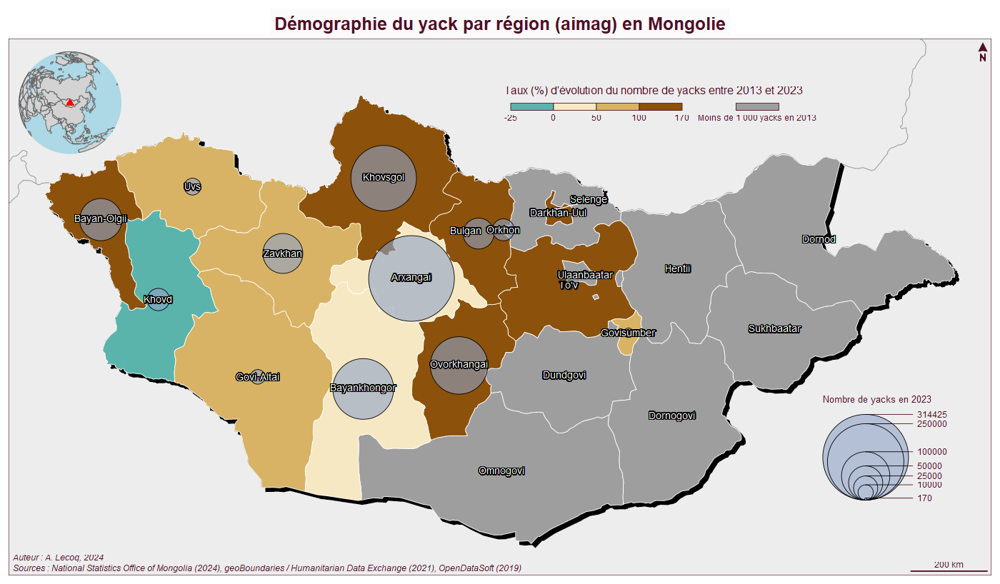

# Le yack en Mongolie : effectifs 2023 et évolution depuis 2013

Carte réalisée en R avec `mapsf` pour le cours de cartographie et géovisualisation du M1 Géomatique (2024), puis reprise en 2026. Elle croise deux informations par aimag (région) : l'évolution du nombre de yacks entre 2013 et 2023 en aplats, et le nombre de yacks en 2023 en cercles proportionnels.



## Ce que montre la carte

Le cheptel recensé passe de 615 000 à 1 063 000 yacks entre 2013 et 2023 (+73 %). Il reste concentré dans les aimags de montagne et de steppe du centre et du nord-ouest : Arxangai (314 000 têtes en 2023), Khovsgol (184 000), Bayankhongor (158 000) et Ovorkhangai (141 000). Ovorkhangai et Khovsgol ont plus que doublé.

Dans l'est et le sud (Dornod, Dornogovi, Dundgovi, Sukhbaatar, Omnogovi, Hentii, Selenge) et à Ulaanbaatar, on compte de quelques unités à quelques centaines de yacks. Sur des bases aussi faibles, le taux d'évolution ne veut rien dire : Dornod passe de 9 à 252 têtes, soit +2 700 %. Ces 8 aimags sont en gris sur la carte. Seul le Khovd recule (−20 %).

## Données à surveiller

- Dornogovi : la source donne 0,1 yack en 2013 et 1,2 en 2023. Ces valeurs sont impossibles, elles sont mises à NA dans le script.
- La version de 2024 calculait le taux partout. Les plus grandes surfaces colorées étaient alors les aimags sans yacks, avec des taux de −100 % à +2 700 %.

## Méthode

- Projection azimutale équivalente de Lambert centrée sur la Mongolie (47° N, 103° E) : les surfaces des aplats et la barre d'échelle sont justes. La version de 2024 était en Web Mercator (EPSG:3857), qui gonfle les distances de 35 à 60 % selon la latitude : l'ancienne barre de 400 km en mesurait en réalité moins de 300.
- Taux d'évolution = (effectif 2023 − effectif 2013) / effectif 2013 × 100, calculé seulement si l'aimag comptait au moins 1 000 yacks en 2013. Quatre classes : une de baisse (−25 à 0 %) et trois de hausse (0-50, 50-100, 100-170 %), dans les couleurs de la palette BrBG.
- Cercles placés au centroïde de chaque aimag, surface proportionnelle au nombre de yacks.

## Refaire la carte

Ouvre `yack_mongolie.Rproj` dans RStudio, installe si besoin `install.packages(c("here", "sf", "dplyr", "mapsf"))`, puis lance `carte_yack_mongolie.R`. La carte est écrite dans `figures/carte_yack_mongolie.png`.

## Contenu du dépôt

```
carte_yack_mongolie.R   import, préparation et carte
Donnees/                effectifs de yacks par aimag (CSV), limites des aimags et des pays (GeoJSON)
figures/                carte produite par le script
```

## Sources

- Effectifs de yacks par aimag, 2013 et 2023 : National Statistics Office of Mongolia (2024).
- Limites des aimags : geoBoundaries (ADM1), via Humanitarian Data Exchange (2021).
- Limites des pays : World Administrative Boundaries, OpenDataSoft (2019).

Réalisation : Armand Lecoq.
